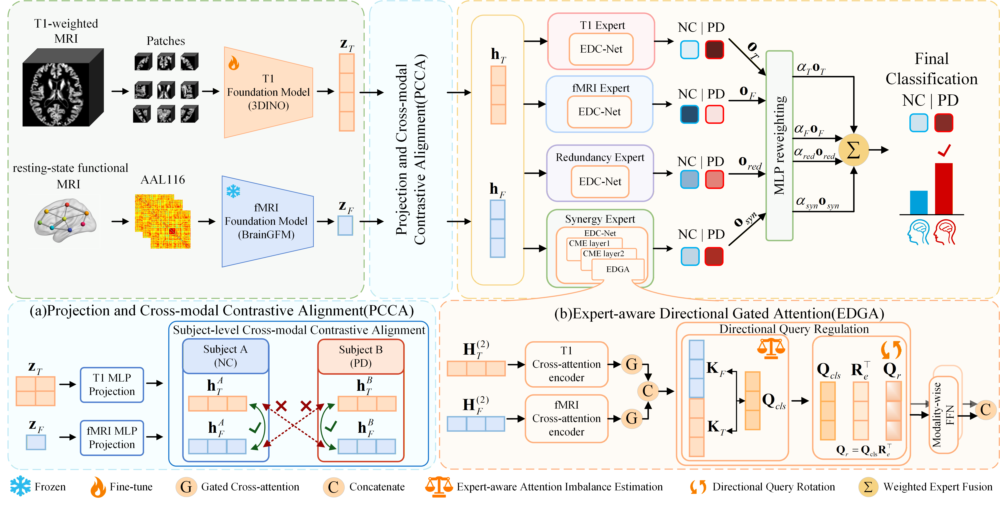

# 🧠 C2I-MoE

This repository provides the structural and functional encoders, cross-modal
contrastive alignment, interaction experts, query regulation, and the training
and evaluation pipeline for C2I-MoE.

## 🧩 Model overview



**Figure 1. Overview of C2I-MoE.** 3DINO and BrainGFM extract structural and
functional features from T1 MRI and rs-fMRI, respectively. Cross-modal
contrastive alignment and expert-aware fusion combine these representations
for Parkinson's disease classification.

## ⚙️ Installation

Python 3.10 is recommended. Install a PyTorch build compatible with your GPU
and CUDA driver, then install the remaining dependencies:

```bash
python -m pip install -r requirements.txt
```

The recorded training environment used PyTorch 2.7.0 with CUDA 12.8,
NumPy 1.26.4, SciPy 1.12.0, scikit-learn 1.7.2, and nibabel 5.1.0.

The code can run on CPU, but full 3DINO fine-tuning is intended for a GPU
with sufficient memory. Lower `--batch-size` when needed.

## 📦 Data and pretrained models

Supply your own preprocessed paired inputs. No patient imaging, subject
identifiers, cohort split files, or model weights are included in this repository.

The training data reader expects this layout (the identifiers below are synthetic):

```text
T1/
  NC/m0wrp1NC001_T1w.nii
  PD/m0wrp1PD001_T1w.nii
fMRI/
  NC/sub-NC001/sub-NC001_Classic_results.mat
  PD/sub-PD001/sub-PD001_Classic_results.mat
```

- T1 volumes must already have shape `112 x 112 x 112`.
- Each MATLAB file must contain `corr_matrix` with `116 x 116` AAL116
  connectivity values. The reader clips negative values, sets diagonal values
  to 1, symmetrizes the matrix, and uses an adjacency threshold of `0.3`.
- The reader matches subject/session names. It does not perform MRI
  preprocessing, registration, fMRI denoising, or quality control.
- Labels are `NC=0` and `PD=1`.

### 📥 Pretrained weights

Download the foundation-model checkpoints from the original authors:

| Encoder | Official source | Checkpoint file |
| --- | --- | --- |
| 3DINO (T1 MRI) | [Hugging Face: AICONSlab/3DINO-ViT](https://huggingface.co/AICONSlab/3DINO-ViT) | `3dino_vit_weights.pth` |
| BrainGFM (rs-fMRI) | [BrainGFM pretrained checkpoint](https://github.com/weixinxu666/BrainGFM/blob/main/checkpoint/BrainGFM_pretrained.pth) | `BrainGFM_pretrained.pth` |

For example, save both checkpoints in a local `weights/` directory:

```bash
mkdir -p weights
curl -L --fail \
  "https://huggingface.co/AICONSlab/3DINO-ViT/resolve/main/3dino_vit_weights.pth?download=true" \
  -o weights/3dino_vit_weights.pth
curl -L --fail \
  "https://raw.githubusercontent.com/weixinxu666/BrainGFM/main/checkpoint/BrainGFM_pretrained.pth" \
  -o weights/BrainGFM_pretrained.pth
```

These are third-party pretrained weights and are not distributed with C2I-MoE.
Please follow the original authors' access and licensing terms. Pass the local
checkpoint paths using `--t1-pretrained` and `--fmri-pretrained`, as shown below.

Optional local Bio_ClinicalBERT assets can be specified with
`C2IMOE_CLINICALBERT_DIR`; if unavailable, the BrainGFM initializer uses fallback
embeddings. Encoder checkpoints overwrite the corresponding stored parameters.

## 🚀 Training

Start training with explicit paths:

```bash
python train.py \
  --t1-root /path/to/T1 \
  --fmri-root /path/to/fMRI \
  --t1-pretrained weights/3dino_vit_weights.pth \
  --fmri-pretrained weights/BrainGFM_pretrained.pth \
  --output-dir outputs/private
```

Default training settings are batch size 28, 50 epochs, interaction-loss
weight 0.5, contrastive-loss weight 0.02, and temperature 0.10. The architecture
uses 768-dimensional fusion embeddings, 128-dimensional training-only
contrastive heads, and three fusion layers per expert.

All generated files stay in `--output-dir`: the selected checkpoint,
`train_config.json`, `metrics.json`, and `divide/` containing the generated
subject-level split CSV and test-error records. Use a separate directory per run.

The data split assigns approximately 70%/15%/15% of subjects to
training/validation/test. The validation and test partitions target a PD
proportion of 0.8; remaining subjects form the training partition. All visits
from the same subject remain in the same partition.

To initialize fine-tuning from a complete C2I-MoE checkpoint, add
`--init-checkpoint /path/to/trained_checkpoint.pth`.

## 🧪 Evaluation

Evaluate only the selected held-out partition using the split file from training:

```bash
python test.py \
  --checkpoint /path/to/trained_checkpoint.pth \
  --t1-root /path/to/T1 --fmri-root /path/to/fMRI \
  --split-csv /path/to/training_split.csv \
  --output outputs/private/test_metrics.json
```

Replace the checkpoint and split paths with the files generated by your training run.

For PPMI evaluation, add `--layout ppmi` and provide the cohort's split CSV
and corresponding fine-tuned checkpoint.

If all supplied inputs deliberately form a separate evaluation cohort, replace
`--split-csv ...` with `--all-subjects`. This explicit choice prevents evaluation
on the whole training cohort by accident.

Evaluation uses the highest softmax probability for classification and the PD
probability for AUC. JSON metrics use values between 0 and 1. The reported
confusion matrix has rows=true labels and columns=predicted labels in `[NC, PD]`
order. AUC is `null` when the selected inputs contain only one class.

Checkpoints are loaded strictly. `--allow-missing-contrast-heads` permits only
missing training-only contrastive-head weights; missing
encoder, expert, gate, classifier, or rotation-buffer weights still fail.

## 🗂️ Code layout

```text
train.py                  command-line training entry
training.py               training and query-regulation loop
test.py                   single-checkpoint evaluation entry
fusion_model.py           foundation extractors, projection, contrastive loss, fusion
expert_fusion.py           gated directional expert
InteractionMoE.py          interaction experts and adaptive reweighting
paired_dataset.py          private-cohort paired-input loader
ppmi_dataset.py            PPMI paired-input loader
split_dataset.py           subject-level split generation
evaluation.py              split selection and aggregate classification metrics
checkpoint_utils.py        strict checkpoint loading
encoders/                  local structural/functional encoder implementations
attention/                 gated and unified attention blocks
utils/                     MLP, layer-wise learning-rate decay, query rotation
tests/                     software checks with synthetic inputs
third_party/               retained upstream license and attribution notes
assets/                    model architecture figure used in this README
```

## 📚 Attribution and licensing

Please cite the C2I-MoE BIBM 2026 paper when using this implementation, along
with the original 3DINO, BrainGFM, I2MoE, and RollingQ works as appropriate.
No repository-wide reuse license has been specified.
Third-party terms remain applicable; see `third_party/NOTICE.md`.

## ✅ Software checks

```bash
python -m pip install pytest
python -m pytest tests -q
```

The checks use synthetic inputs and small stand-in encoders to verify fusion,
gradient propagation, saved rotation buffers, dataset loading, split selection,
and classification metrics.
